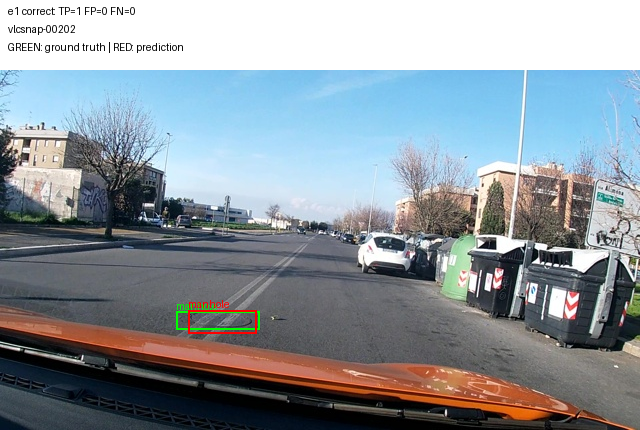
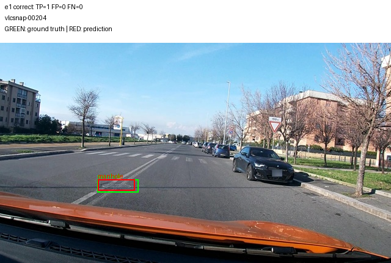
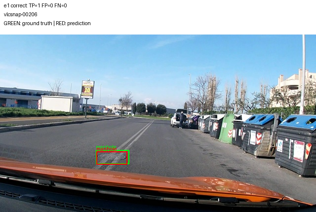
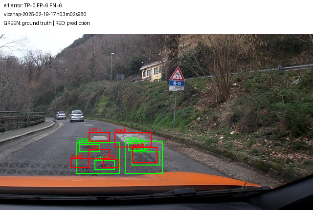
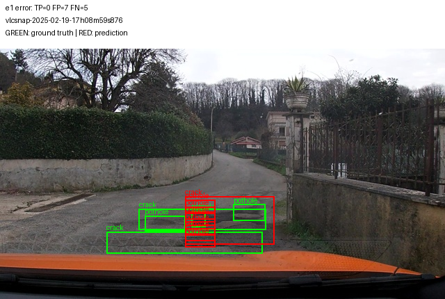
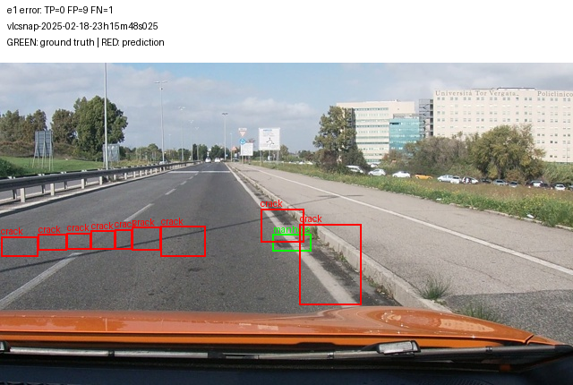

# Ảnh minh hoạ từ dự đoán thật

`vlcsnap-00202` — TP=1, FP=0, FN=0. Box xanh: nhãn thật; box đỏ: dự đoán.

`vlcsnap-00204` — TP=1, FP=0, FN=0. Box xanh: nhãn thật; box đỏ: dự đoán.

`vlcsnap-00206` — TP=1, FP=0, FN=0. Box xanh: nhãn thật; box đỏ: dự đoán.

`vlcsnap-2025-02-19-17h03m02s980` — TP=0, FP=6, FN=6. Box xanh: nhãn thật; box đỏ: dự đoán.

`vlcsnap-2025-02-19-17h08m59s876` — TP=0, FP=7, FN=5. Box xanh: nhãn thật; box đỏ: dự đoán.

`vlcsnap-2025-02-18-23h15m48s025` — TP=0, FP=9, FN=1. Box xanh: nhãn thật; box đỏ: dự đoán.
